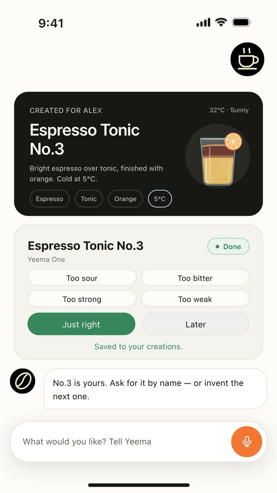
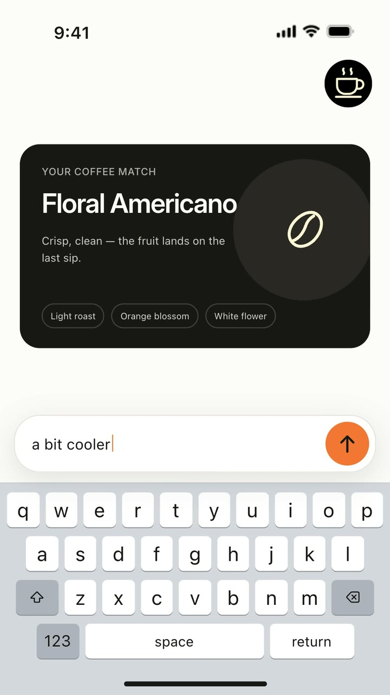
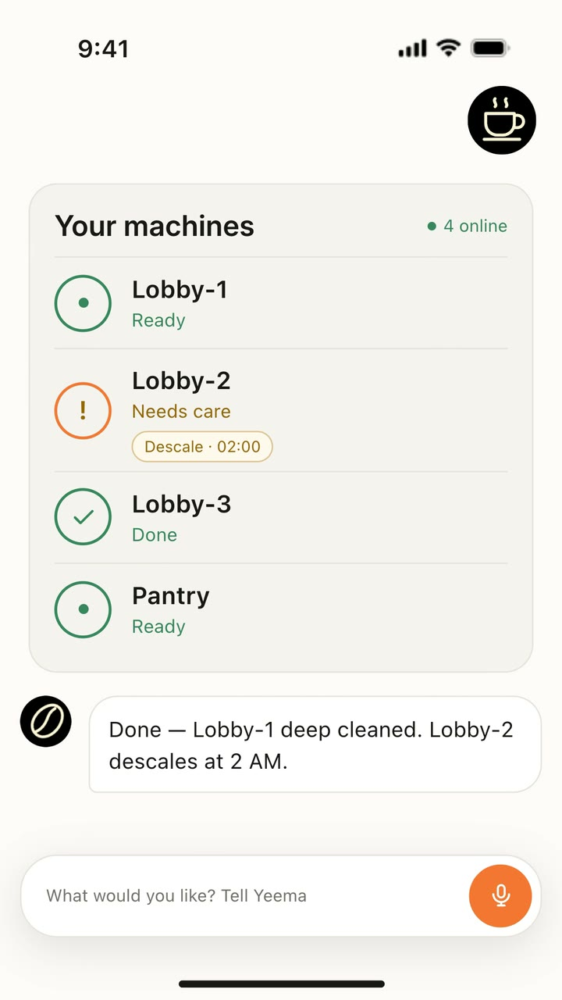
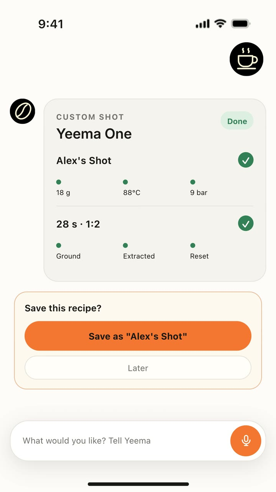
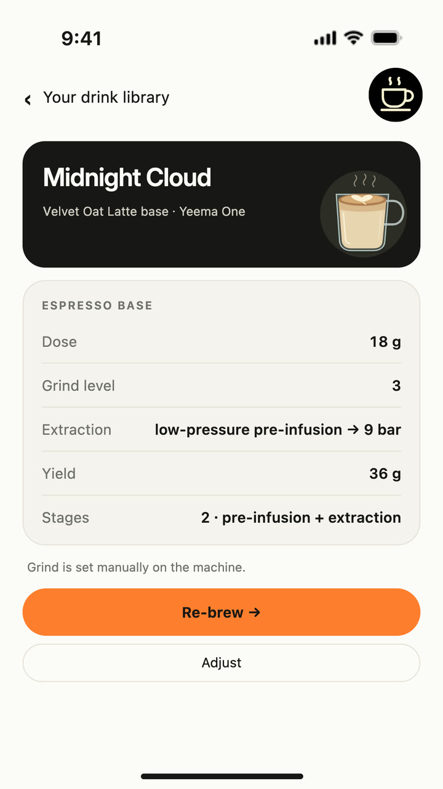

<h1 align="center">Coffee Buddy × Yeema One</h1>

<p align="center"><b>展会竖屏 AI 咖啡机交互演示</b> · HyperFrames 系列工程与交付记录</p>

<p align="center">
  
</p>

**一句话**：全部画面都发生在 Coffee Buddy 手机 APP 的聊天界面里 —— 用一条连续的对话，把「用户说需求 → AI 理解 → 用户确认 → 放杯 → 机器执行 → 反馈与保存复用」讲清楚。现场用真机做咖啡，屏幕负责让人**一眼看懂机器会什么**。

章节编号沿用客户既有编号（本仓库没有 Ch.3 / Ch.5），每章是**独立工程**：独立的文件夹、composition ID、时间线和成片文件，互不覆盖。

## 规格

| 项目 | 参数 |
| --- | --- |
| 画幅 | 1080 × 1920（9:16 竖屏） |
| 帧率 | 30 fps |
| 语言 | 英文 UI（文档中英混排） |
| 声音 | 轻音效；**无配音、无背景音乐** |
| 画面 | 满屏 APP 聊天界面，暖白画布 + 橙色强调，一套统一的卡片语言 |
| 实现 | HTML + CSS + GSAP 时间线（可 seek），由 HyperFrames CLI 检查与渲染 |
| 时长 | 每章 22 – 34.4 秒 |
| 用途 | 展会现场竖屏循环播放 |

## 章节

| 章节 | 演示的能力 | 时长 | 状态 | 入口 |
| --- | --- | --- | --- | --- |
| **Ch.1**<br>`coffee-buddy-demo` | 语音/文字输入 → 味觉理解 → 推荐 → 微调参数 → 放杯 → 冲泡 → 口感反馈 → 保存口味 | 26.0 s | 已交付 v2（含音效） | [成片 v2](coffee-buddy-demo/coffee-buddy-ch1-demo-v2.mp4) · [交付记录](coffee-buddy-demo/CH1-DELIVERY.md) |
| **Ch.2**<br>`coffee-buddy-ch2` | 一句话点两杯：一句自然语言里含两种出品，AI 解析后按顺序执行 | 22.0 s | 动画已搭建，**未导出成片** | [composition](coffee-buddy-ch2/index.html) · [故事版](coffee-buddy-ch2/STORYBOARD.md) |
| **Ch.4**<br>`coffee-buddy-ch4` | 多机管理：一句话给门店排维护，四台机器各自报状态 | 22.0 s | 已交付 | [成片](coffee-buddy-ch4/coffee-buddy-ch4-demo.mp4) · [BRIEF](coffee-buddy-ch4/BRIEF.md) |
| **Ch.6**<br>`coffee-buddy-ch6` | 精确参数：五个参数自定义一杯，命名保存后可复用 | 24.0 s | 已交付 final v1 | [成片](coffee-buddy-ch6/renders/coffee-buddy-ch6-final-v1.mp4) · [静态故事版](coffee-buddy-ch6/storyboard.htm) |
| **Ch.7**<br>`coffee-buddy-ch7` | 现场创作：按场景与现有原料发明一杯 Espresso Tonic | 24.0 s | 动态预览已验收，成片待最终确认 | [预览渲染](coffee-buddy-ch7/renders/coffee-buddy-ch7_2026-10-14_13-02-13.mp4) · [交付说明](coffee-buddy-ch7/CH7-DELIVERY.md) |
| **Ch.8**<br>`coffee-buddy-ch8` | 命名 · 保存 · 复用：把一杯变成个人饮品库里可复现的配方 | 34.4 s | v5 动态预览通过并导出 v1<br>（成片文件未随项目保留） | [composition](coffee-buddy-ch8/index.html) · [BRIEF](coffee-buddy-ch8/BRIEF.md) |
| **交接包**<br>`coffee-buddy-handoff` | Ch.6 全量交付参考：已确认源码、41 项原样素材、关键帧、成片与检查记录 | — | 可直接复用 | [交接 README](coffee-buddy-handoff/README.md) |

> GitHub 页面可直接播放仓库里的 `.mp4`，点开「成片」即可预览。

## 画面

<table>
  <tr>
    <td align="center"></td>
    <td align="center"></td>
    <td align="center"></td>
    <td align="center"></td>
    <td align="center"></td>
  </tr>
  <tr>
    <td align="center"><sub>Ch.1 推荐卡与「a bit cooler」</sub></td>
    <td align="center"><sub>Ch.4 四台机器并发状态</sub></td>
    <td align="center"><sub>Ch.6 自定义参数与保存配方</sub></td>
    <td align="center"><sub>Ch.7 Espresso Tonic No.3</sub></td>
    <td align="center"><sub>Ch.8 饮品库中的配方详情</sub></td>
  </tr>
</table>

> 截帧取自各章成片（Ch.8 取自 `boards/stills/`）；Ch.2 尚未导出成片，因此暂无截帧。

## 分章说明

### Ch.1 · 一杯咖啡的完整闭环（26.0 s / 780 帧）

- 长按语音 → 味觉理解涟漪 → **Floral Americano** 推荐卡 → 输入 `a bit cooler` → 温度改到 88 ℃ → 饮品确认 → 放杯确认 → Grinding / Extraction / Disposing / Resetting → Done → `Just right` → 保存口味。
- 39 个同步音效节点；57/57 项文字对比度检查通过；成片音轨与参考混音相关度 0.997。
- 保留首版无声文件 `coffee-buddy-ch1-demo.mp4` 用于对比；`coffee-buddy-demo.mp4` 是最早的 20 秒测试片。
- 工程位置：[coffee-buddy-demo](coffee-buddy-demo)，CLI 锁定 0.8.152。

### Ch.2 · 一句话，两杯（22.0 s）

- 一句话里带两种出品与两种服务方式：`A double espresso for here, and a latte to go.`
- 依次是：键盘输入整句 → `Yeema is reading your order` → 理解胶囊 → 两张饮品 chip → 双饮品订单卡 → 一次放两个杯 → 两行 brew 卡**串行**执行 → 口感反馈。
- 新增组件：双饮品订单卡、两行制作卡（Figma 单饮品卡片的延伸）。
- 动画时间线已完成（`index.html`，可 seek），**尚未导出成片**。
- 工程位置：[coffee-buddy-ch2](coffee-buddy-ch2)，CLI 锁定 0.8.157。

### Ch.4 · 一个 APP 管一个门店（22.0 s）

- 机器主动报修提醒 → 一句话下发两个动作：`Descale Lobby-2 at 2 AM, and deep clean Lobby-1 now.`
- 四台机器把**并发状态**摊开：Lobby-1 清洁后转绿、Lobby-3 冲煮后转绿、Lobby-2 **仍然橙色 Needs care**（预约 ≠ 完成）、Pantry 一直 Ready。
- 15 个音效片段；16 个采样点零布局问题；83/83 对比度通过。
- 新增组件：四行 machine 卡（Figma 机器状态语汇的延伸）。
- 工程位置：[coffee-buddy-ch4](coffee-buddy-ch4)，CLI 锁定 0.8.157。

### Ch.6 · 自定义参数（24.0 s / 720 帧）

- `Pull my shot at 88°C, 9 bar...` → 五个参数锁定（18 g / 88 ℃ / 9 bar / 28 s / 1:2）→ 放杯确认 → 制作 → 命名 **Alex's Shot** → 保存 → 下次一句话复用。
- 保留 `Grind is set manually on the machine.`：粉量是卡内给定参数，研磨度不被写成 AI 可控项。
- 本章修复了**头像压卡 / 卡片重叠**问题，修复规则沉淀成交接文档里的 8 条布局约束。
- `check --samples 25 --at-transitions`：lint / runtime / layout / contrast 全部 0 error、0 warning；音频 peak −20.82 dBFS、削波样本 0。
- 成片 SHA-256：`5ae19efbe215b7a22e4e124141f8db7e95724d2bb5d617a59652749b6ad6be0b`。
- 工程位置：[coffee-buddy-ch6](coffee-buddy-ch6)，CLI 锁定 0.8.180。

### Ch.7 · 现场发明一杯（24.0 s）

- 输入场景：`It's a hot afternoon. I have tonic water and an orange — surprise me.`
- 三滴 + 创作火花 → **Espresso Tonic No.3** 黑色配方卡 → 原料落杯、缩嵌 → `Make it →` → 放杯确认 → 浓缩执行 → `Just right` → 保存到 creations。
- 物理边界写清楚：`over tonic`（浓缩在汤力水上层）、`Espresso only. Add tonic and orange yourself.`
- 23 个音效片段；71/71 对比度通过；零 error / warning / info。
- 工程位置：[coffee-buddy-ch7](coffee-buddy-ch7)，CLI 锁定 0.8.155。

### Ch.8 · 命名、保存、复用（34.4 s / 1032 帧）

- 一杯 **Velvet Oat Latte** → 口感评分 → 命名 **Midnight Cloud** → 进入「Your drink library」→ 配方详情（18 g / grind 3 / 低压预浸 → 9 bar / 36 g 出品 / 2 段）→ `Re-brew →` 用同一套 4 秒流程再做一次。
- 两次完整冲泡（研磨、萃取/奶泡、排渣、复位）+ 评分卡 + 命名卡 + 库页 + 配方页，是本章新增的**应用内页面**。
- 28 个音效片段；v5「堆叠卡片」修订后通过审批并导出 v1。
- 工程位置：[coffee-buddy-ch8](coffee-buddy-ch8)，CLI 锁定 0.8.180。

## 目录结构

```text
coffee-buddy-hyf/
├── docs/stills/                 # README 用截帧（720×1280）
├── coffee-buddy-demo/           # Ch.1
│   ├── index.html               # 可 seek 的 GSAP 时间线 + 音效排布
│   ├── animation.js
│   ├── assets/                  # 字体 / 头像 / Figma 图标 / 音效
│   ├── coffee-buddy-ch1-demo-v2.mp4
│   └── CH1-DELIVERY.md
├── coffee-buddy-ch2/            # Ch.2  BRIEF / STORYBOARD / STORYBOARD-SOURCE
├── coffee-buddy-ch4/            # Ch.4  + 成片、scripts/
├── coffee-buddy-ch6/            # Ch.6  + renders/、output/export（检查记录）
├── coffee-buddy-ch7/            # Ch.7  + animation.js、figma-reference/
├── coffee-buddy-ch8/            # Ch.8  + motion.js / ui.js / boards/
└── coffee-buddy-handoff/        # Ch.6 交接包
    ├── reference-ch6/           # 已确认的 Ch.6 源码与素材（新章可直接复制）
    ├── reference-video/         # 已交付成片
    ├── visual-reference/        # 关键帧 / 转场 / 编码后抽帧
    ├── series-extras/           # Ch.1 Figma 原始图形
    ├── verification/            # 布局扫描与成片技术核对 JSON
    └── ASSET-MANIFEST.json      # 41 项素材的 SHA-256 清单
```

每个章节目录通常包含：

| 文件 | 作用 |
| --- | --- |
| `index.html` | 主 composition：结构 + CSS + GSAP 时间线 + `<audio>` 音效排布 |
| `BRIEF.md` | 本章目标、规格、已确认决策、当前状态 |
| `STORYBOARD.md` | 分镜与制作后的状态记录 |
| `STORYBOARD-SOURCE.md` | 客户原始故事版的**逐字节副本**（只读参考） |
| `storyboard.htm` | 静态关键画面审阅页（`.htm` 后缀避免被 CLI 当成视频入口） |
| `frame.md` / `DESIGN.md` | 画面设计与动效说明 |
| `package.json` | `dev` / `check` / `render` / `publish` 脚本与锁定的 CLI 版本 |
| `assets/` | 本地字体、头像、Figma 图标、音效（含 `sfx/CREDITS.md`、`sources.json`） |

## 本地运行

需要 Node.js 18+ 与网络（首次运行会用 `npx` 下载对应版本的 HyperFrames CLI）。每个项目独立运行，命令都在**该章节目录**里执行。

```sh
cd coffee-buddy-ch4

npm run dev      # 启动预览（后台服务，端口由 CLI 分配）
npm run check    # lint / runtime / layout / contrast 检查
npm run render   # 按 package.json 里配置的输出名导出
```

预览地址形如 `http://localhost:<port>/#project/<composition-id>`。端口每次可能不同，以终端输出为准；旧地址不要当成永久链接。

强检查与交付级导出（以 Ch.6 为例）：

```sh
npx --yes hyperframes@0.8.180 check --samples 25 --at-transitions --json
npx --yes hyperframes@0.8.180 render --quality delivery --fps 30 \
  --output renders/coffee-buddy-ch6-final-v2.mp4
ffprobe -v error -show_entries stream=codec_name,codec_type,width,height,avg_frame_rate,nb_frames,sample_rate,channels \
  -show_entries format=duration,size -of json renders/coffee-buddy-ch6-final-v2.mp4
```

| 章节 | CLI 版本 | 输出名 |
| --- | --- | --- |
| Ch.1 `coffee-buddy-demo` | 0.8.152 | `coffee-buddy-ch1-demo-v2.mp4` |
| Ch.2 `coffee-buddy-ch2` | 0.8.157 | 未配置导出 |
| Ch.4 `coffee-buddy-ch4` | 0.8.157 | `coffee-buddy-ch4-demo.mp4` |
| Ch.6 `coffee-buddy-ch6` | 0.8.180 | `coffee-buddy-ch6-demo.mp4` / `renders/coffee-buddy-ch6-final-v1.mp4` |
| Ch.7 `coffee-buddy-ch7` | 0.8.155 | `coffee-buddy-ch7-demo.mp4` |
| Ch.8 `coffee-buddy-ch8` | 0.8.180 | `renders/coffee-buddy-ch8-final-v1.mp4` |

> 新版本导出另起 `v2`、`v3` 文件名，不要覆盖已交付的成片。

## 设计规范（复现要点）

### 颜色

| 用途 | 值 |
| --- | --- |
| 暖白画布 | `#fcfbf9` |
| 浅色卡片 | `#f5f3ee` |
| 分隔线 / 边框 | `#e7e3da` |
| 正文 / 深色气泡 | `#171715` |
| 次级文字 | `#6f706a` |
| 强调 / 操作橙 | `#ff7e2e` |
| 完成绿（Ch.6） | `#2c7555` |
| 完成绿（Ch.1 / 4 / 7 部分状态） | `#2f7d5b` |
| 浅绿状态底 | `#dcece3` |

### 字体与版式

- 正文 **SF Pro**、标题 **Inter**，均为项目内本地字体（`assets/fonts/`）；布局在 `document.fonts.ready` 之后按实际 `offsetHeight` 测量。
- 源码以 **393 × 698.666667** 的 APP 逻辑画布排版，整体按 `1080 / 393 = 2.748091603` 等比放大；数值都是逻辑像素，不要二次缩放。
- 聊天视口 `top:128px; left:14px; right:14px; bottom:108px`；聊天行总宽 365px = 36px 头像 + 12px 间距 + **317px** 卡片；不带头像的满宽卡 353px（左右各内缩 6px）。
- 主卡圆角 20px，主要按钮高 42px / 圆角 22px，麦克风与波形共用 44px 槽位。

### 头像

| 角色 / 位置 | 文件 | 规则 |
| --- | --- | --- |
| Coffee Buddy（聊天左侧） | `assets/avatars/coffee-buddy-bean.svg` | 黑圆底 + 暖浅色咖啡豆线稿 |
| 用户（聊天右侧） | `assets/avatars/user-cup-chat.svg` | 黑圆底 + 咖啡杯线稿 |
| 用户（右上大头像） | `assets/avatars/user-cup.svg` | 与右侧聊天气泡头像同一张杯子，只放大 |

不使用照片或 emoji，也不重新生成头像。

### 动效与音效

- 克制、清楚、像真实 APP 操作：卡片入场 0.22–0.42 s、位移 8–12 px，`power2.out` 落定，滚动 `power2.inOut`，按钮按下缩到 0.96。
- 三滴、涟漪、扫光、蒸汽只在故事版安排的段落出现，不常驻循环；Ch.7 的原料落杯属于章节专属，不变成通用开场。
- 音效全部由 `<audio data-start / data-duration / data-media-start / data-volume>` 排布，交给 HyperFrames 驱动；不放 GSAP 回调里 `play()`。当前素材参考响度 0.07–0.18。
- 流程上**不能跳开放杯确认**（`Cup is in place`）直接开始制作；制作阶段保留 Stop 入口。

### 防重叠（沿用 Ch.6 修复规则）

1. 有定位 CSS 的节点必须带对应 class（如 `#lock-group` 同时有 `lock-group assistant`）。
2. 317px 助手卡已含在 365px 行预算内，别把 353px 满宽卡塞到头像旁。
3. 参数 chips 已在头像右侧内容列，不再叠加 48px 左边距。
4. 文字换行会改变卡高：字体加载后按 `offsetHeight` 计算后续卡位置，保留 12–20px 间距。
5. 不要给整个聊天容器加忽略标记来「通过」检查；滚动先把卡送进视口，再出下一张卡。

## 制作流程

1. **读故事版**：确定本章要让观众记住的一个能力 + 时长。
2. **静态关键画面**：用原字体、原头像、原组件尺寸搭出 6 格关键帧，先请客户确认。
3. **动态预览**：时间线暂停且可 seek，注册到 `window.__timelines["<composition-id>"]`；客户确认动态预览后才进入导出。
4. **导出与核对**：`render --quality delivery --fps 30`，再用 `ffprobe` 核对分辨率、帧数、帧率、音轨，并抽看编码后的画面。
5. **交付记录**：写 `CHx-DELIVERY.md`（或 `DELIVERY.md`），记录文件位置、SHA-256、检查结果。

硬性门槛：**没有本章动态预览的确认，不导出成片**；历史章节的授权不自动转移到新章；已有章节必须保留，新章另建文件夹、ID 与输出名。

## 质量校验

- `check --samples 25 --at-transitions`：lint / runtime / layout / contrast 逐项过，看的是数量而不只是退出码。
- 随机 seek、倒序 seek、从头重播都要回到同一画面（打字文本、保存状态、卡片透明度、滚动位置）。
- 稳定停留帧与转场中间帧逐帧看：头像不压卡、chips 不越界、数字不碰按钮、旧文字不与新文字重叠。
- 实际 MP4：非空、1080×1920、30 fps、帧数正确、音轨存在、无削波；抽看开头 / 中段 / 结尾。

## 素材与授权

- **设计来源**：Figma 文件 *Yeema Design Tokens*（file `an1HkDGtEQctMpe3MwNcsb`，Page 1）。关键节点：`537:1071` Home Ready、`537:1074` talk/texting、`537:3337` 任务状态卡、`715:4937` 机器状态 / workbench。
- **字体**：`SF-Pro-ch1.woff2`、`Inter-ch1.woff2` 等为本地字体文件。Inter 为 SIL OFL 1.1；**SF Pro 是 Apple 的授权字体**，公开分发前请自行确认许可范围，或替换为可再分发的等宽/无衬线替代字体后重新排版。
- **音效**：来源、加工记录与哈希见各项目 `assets/sfx/CREDITS.md` 与 `sources.json`。研磨、萃取、排渣、复位、水流、蒸汽均为**示意素材，不是 Yeema 真机录音**。
- **品牌素材**：Coffee Buddy / Yeema / Yeema One 的头像、图标、文案与视觉资产归权利人所有。本仓库是制作存档；**对外发布、商用或转授权请先取得相应授权**（`coffee-buddy-handoff/README.md` 第 8 节有同样的提醒）。

## 关于本仓库

- 本仓库由本地 7 个项目文件夹整理合并而成，保留各章原始目录名，方便与交接文档里的路径对照。
- 已忽略本地缓存与工具状态：`.hyperframes/`（预览、审阅帧、时间线状态）、`.thumbnails/`、`.waveform-cache/`、`.playwright-cli/`、`.DS_Store`。它们可以重新生成，因此不入库。
- 成片为 H.264 + AAC，单文件 1.5–2.9 MB，GitHub 页面可直接播放。
- 已知缺口（如实记录）：Ch.2 未导出成片；Ch.8 的 v1 成片文件未随项目保留，可用 `npm run render` 按 `BRIEF.md` 记录的参数重新导出；Ch.7 的 `renders/` 里是一条 24 秒预览渲染，尚未走完最终导出确认。

---

<p align="center"><sub>Coffee Buddy × Yeema One · 1080×1920 · 30 fps · HyperFrames · 2026</sub></p>
